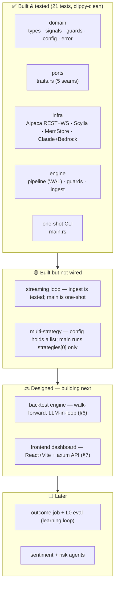
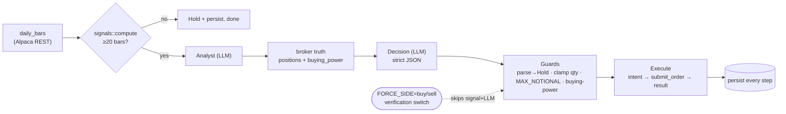
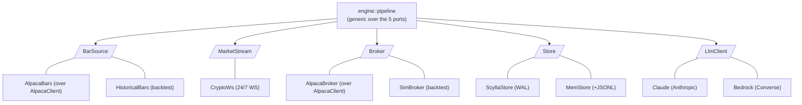
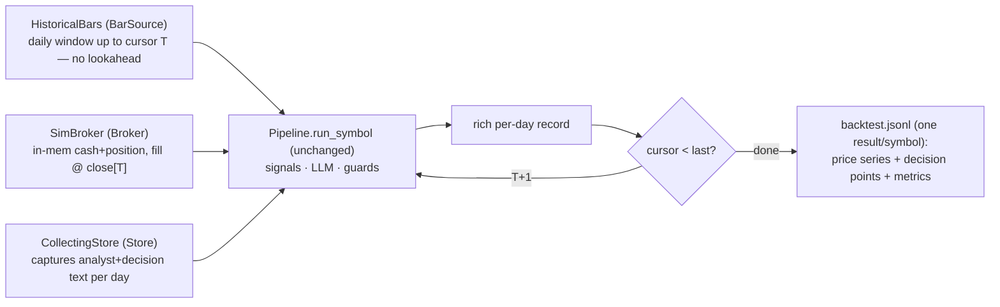
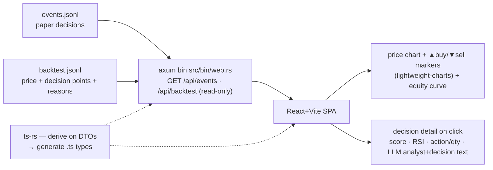

# alpaca-trading-system-rust — Multi-Agent AI Crypto Trading (Rust)

A hand-rolled pipeline of LLM agents that reads a crypto symbol, decides
**Buy/Sell/Hold** on an Alpaca **paper** account, and writes an append-only audit
log that doubles as the dataset for improving the system over time.

**Principles:** crypto-first · Alpaca **paper only** (fail-closed live barrier) ·
ScyllaDB from day one · no agent framework — **math in Rust, LLM does judgment**.

---

## 1. Status — built vs planned



---

## 2. Existing system — one decision cycle (what runs today)

`cargo run` executes **one cycle per symbol** of `strategies[0]`, then exits. Every
step is persisted (WAL): `order_intent` **before** the broker call, `order_result`
**after** — a crash between them leaves a recoverable intent, never a silent order.



**Run modes (env):**

| Var | Values | Effect |
|---|---|---|
| `STORE` | `memory` \| _(scylla)_ | in-memory + optional JSONL trail, or real Scylla WAL |
| `LLM` | `bedrock` \| _(anthropic)_ | Amazon Bedrock (bearer key) or Anthropic direct |
| `FORCE_SIDE` | `buy` \| `sell` \| _(off)_ | bypass signal+LLM, place one guarded order (verification) |
| `EVENTS_PATH` | path | in memory mode, append every step as a JSON line for `jq` |
| `MAX_NOTIONAL` | USD | per-order cap enforced by guards (Alpaca crypto min = **$10**) |
| `ALLOW_LIVE` | `1` | required to use a non-paper base; else refused (fail-closed) |

---

## 3. Architecture — ports & adapters

The engine depends only on **5 traits**; each has swappable adapters. New data
source / store / LLM = new impl, **no pipeline change**.



Alpaca stays **source of truth** for orders/positions (fetched live each run; not
cached). We own only the append-only `events` log.

---

## 4. Persistence (Scylla) — two tables

Everything for a `(strategy, symbol)` lands in one partition, so the outcome join
and eval queries stay partition-local (no cross-partition scans).

```sql
CREATE TABLE trading.events (          -- append-only audit, one row per step, kept forever
  strategy_id text, symbol text, ts timestamp,
  step text,        -- market_data | analyst | decision | guard | order_intent | order_result | outcome
  decision_id text, -- = strategy_id : symbol : trading_day
  payload text,     -- JSON blob
  PRIMARY KEY ((strategy_id, symbol), ts, step)   -- step in clustering key: no same-ts overwrite
) WITH CLUSTERING ORDER BY (ts DESC, step ASC);

CREATE TABLE trading.market_data (     -- Scylla's real use case: tick firehose, read by symbol+range
  symbol text, day date, ts timestamp,
  open double, high double, low double, close double, volume double,
  PRIMARY KEY ((symbol, day), ts)      -- bucketed by day so a 24/7 symbol never grows one huge partition
) WITH CLUSTERING ORDER BY (ts DESC) AND default_time_to_live = 2592000;  -- 30d TTL on raw ticks
```

No Scylla? `STORE=memory` runs the full path with a JSONL trail instead. **Inspect:**
`cqlsh` / DBeaver (Cassandra driver) for Scylla; `jq` over `events.jsonl` for memory
mode. (Grafana/Scylla-Monitoring is ops metrics, not row browsing.)

---

## 5. Safety (guards are the only thing between a bad LLM output and a real order)

- **Parse-fail → Hold.** Unparseable/invalid decision never becomes a trade.
- **Clamp qty** to `MAX_NOTIONAL / price`; SELL bounded by actual position.
- **Buying-power check** before submit.
- **Idempotent `client_order_id`** = `(strategy_id, symbol, trading_day)` — a `422`
  duplicate resolves to the existing order (no double-submit, no audit hole).
- **`compute() == None`** (too few bars) → explicit Hold.
- **Live barrier:** non-paper base refused unless `ALLOW_LIVE=1` + loud startup print.

---

## 6. Backtest — walk-forward, reuses the live pipeline

Backtest runs the **same `Pipeline`** (signals → LLM analyst+decision → guards) as
live; only two ports are swapped, so a backtested edge uses the identical decision
chain as paper — no divergent logic. In-tree module `engine/backtest.rs` (no new crate).



- **LLM in the loop** (chosen): each day replays the real analyst+decision agents, so
  the backtest reflects the AI's behavior — cost ≈ `days × 2` LLM calls/symbol, so the
  window is capped (`BACKTEST_DAYS`, default ~90) with a startup cost print.
- **Rich per-day record** (this is what the frontend visualizes): `{ts, close, score,
  rsi, action, qty, decision_reason, analyst_text}`. A `CollectingStore` (tiny `Store`
  impl) grabs the analyst + decision text `run_symbol` persists, so each buy/sell point
  carries **why the LLM chose it**.
- **Metrics**: total return · max drawdown · #trades · vs buy&hold.
- **Reused as-is**: `signals::compute`, `guards::apply`, the whole `Pipeline`, config/LLM wiring.
- `ponytail:` close-to-close fills, no slippage/fees — optimistic upper bound; add a fill
  model when it matters. Unit-tested with a FakeLlm (no Bedrock spend in CI).
- Run: `BACKTEST=1 cargo run` → writes `backtest.jsonl` for the dashboard.

---

## 7. Frontend — visualize decisions on the chart (React + Vite + ts-rs)

**The whole point: see WHERE it bought/sold and WHY.** Buy/sell markers overlaid on the
price chart; click a marker (or a table row) → the signal (score/RSI) + the LLM's
analyst & decision text for that point. Same view for backtest and for live/paper runs.
New `frontend/` folder (node toolchain, physically separate from the Rust crate); a
read-only axum bin serves the data.



- **Chart**: `lightweight-charts` price line/candles with `setMarkers` for buy (▲ green,
  below bar) / sell (▼ red, above bar); a second pane/series for the equity curve.
- **Decision drill-down**: markers and a decisions table are linked to the same records;
  selecting one shows the full signal + LLM reasoning — answers "每条 signal LLM 怎么选的".
- **JS/TS over Rust/WASM** for the chart ecosystem; `ts-rs` generates the TS types from
  the Rust DTO structs, so there's still one source of truth across the boundary.
- **v1 reads the JSONL files** (memory-mode trail + backtest output) — no Scylla query
  seam yet. Reading Scylla later = add a `Store` read method; the SPA is unchanged.
- **Read-only**: the dashboard never places orders; it only displays persisted decisions.

---

## 8. Extend / roadmap (what we can add)

| Add | Trigger | Effort | Notes |
|---|---|---|---|
| **Resident streaming loop** | want intraday/24/7 crypto | small | `ingest` is built+tested; wire `CryptoWs` → pipeline trigger in `main` |
| **Multi-strategy** | >1 strategy | small | config already a list; loop all + one paper account (or `strategy_id` tag) each |
| **Learning loop** | want "越做越好" | medium | `decision_id` exists → add async **outcome** rows (t+1/5/20d P&L) → **L0** pure-Rust eval (hit-rate vs buy-hold) → tune prompt/weights → L2 few-shot RAG |
| **Sentiment + Risk agents** | richer decisions | medium | new steps between Analyst and Decision; fetches are tool-ready (LLM tool-use is additive) |
| **Dashboard reads Scylla** | outgrow JSONL files | small | §7 SPA is unchanged; add a `Store` read method behind the axum API |
| **SQL/QuestDB analytics** | eval outgrows Rust-over-a-partition | deferred | Scylla is weak at aggregation; add only then |

---

## 9. Layout

```
Cargo.toml            single package `alpaca-trading-system`, bin `crypto-agent` (+ `web`)
db/schema.cql         Scylla keyspace + tables (hand-applied)
docker-compose.yml    local Scylla
config/strategies.toml strategies (id, symbols, tempo) — secrets live in .env
src/
  main.rs             binary — load config, pick store+LLM, run one cycle/symbol (or BACKTEST=1)
  lib.rs              declares the layers
  traits/             PORTS — BarSource · MarketStream · Broker · Store · LlmClient · FundamentalSource · NewsSource
  bin/web.rs          read-only axum API (§7) — GET /api/events · /api/backtest
  domain/             types · error · signals + data (dep-free math) · config (TOML+env, live barrier)
  infra/              PORT IMPLS — clients/ (AlpacaClient · AnthropicClient · BedrockClient: transport + wire types)
                      · market.rs (AlpacaBars · CryptoWs) · broker.rs (AlpacaBroker) · store.rs (Scylla · Mem) · llm.rs (Claude · Bedrock)
                      · news.rs (AlpacaNews) · clients/finnhub.rs (FundamentalSource)
  engine/             OVER THE PORTS — pipeline (agents+WAL) · guards · ingest · backtest (§6)
frontend/             React+Vite SPA (§7) — price chart + markers + decision drill-down; ts-rs types
```

**Not doing yet:** agent framework · fine-tuning · per-trade human gate (paper runs
unattended; guards are the safety net). Not investment advice — the signal is a naive
educational heuristic.
